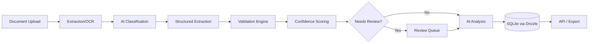

# AI Document Processing & Intelligence Agent

> An AI-powered document intelligence pipeline that transforms unstructured business documents into validated structured data, automated analysis, and human-reviewed workflows.

This is a portfolio project. It's built to be cloned and run in a few minutes, not deployed as-is to production — see [Limitations](#limitations).

## Overview

Businesses that process invoices, purchase orders, receipts and similar paperwork by hand spend real time on data entry, cross-checking totals, and catching errors after the fact. This project automates that pipeline end to end: a document goes in as a PDF or image, and comes out as validated, structured, queryable data — with every uncertain field routed to a human before it's treated as fact.

## Business Problem

Manual invoice processing is slow, error-prone, and hard to audit. A person keys in a vendor name, an invoice number, a total, line items — and any typo or misread number becomes a downstream accounting problem. Scaling that process means hiring more people to do the same repetitive reading and re-typing.

## Solution

An automated pipeline extracts text from a document (via its embedded text layer, or OCR for scans), classifies what kind of document it is, pulls out structured fields for invoices specifically, runs the result through deterministic validation rules (not just "trust the AI"), scores confidence per field, and routes anything uncertain to a review queue where a human can see the original document side by side with what was extracted, correct it, and approve or reject — with every correction logged to an audit trail.

## Core Pipeline

```text
Document
→ Extraction/OCR
→ Classification
→ Structured Extraction
→ Validation
→ Confidence Scoring
→ AI Analysis
→ Human Review
→ Database
→ API/Export
```

## Key Features

Only what's actually implemented and tested:

- Drag-and-drop or file-picker upload (PDF, PNG, JPG)
- Text extraction from PDFs via `pdftotext`, with **automatic fallback to OCR** (`pdftoppm` + Tesseract) when a PDF's text layer is empty or near-empty (i.e. it's a scan)
- Direct OCR for raw image uploads
- Heuristic document classification (invoice / purchase order / receipt / contract / application / report / onboarding document / unknown), with a confidence score
- Structured invoice extraction: vendor, invoice number, dates, currency, PO number, subtotal/tax/discount/total, line items — each field carries its own confidence score
- A deterministic validation engine, independent of the AI layer: required-field checks, `subtotal + tax − discount = total` (with configurable tolerance), per-line-item `quantity × unit price = amount`, date sanity (valid dates, due date not before invoice date), currency recognition, and duplicate-invoice detection against previously stored invoices
- AI-generated summary and anomaly detection, with every anomaly explicitly tagged as either a verified fact (derived from validated numbers) or an AI interpretation — never presented as the same thing
- A configurable confidence threshold that routes low-confidence or validation-failed documents to a Review Queue
- A review UI: original document viewer next to extracted fields, per-field confidence, inline editing, approve/reject/send-back, and a full audit trail (original value, corrected value, reviewer, timestamp) for every correction and decision
- A per-document processing log (every pipeline stage, its status, and its duration)
- JSON and CSV export
- A pluggable AI provider interface with a working zero-cost `MockAIProvider` (deterministic, regex/heuristic-based — no API key, no external calls, no cost) plus `OpenAIProvider`/`AnthropicProvider` implementations for real LLM-based extraction (see [AI Providers](#testing) for what is and isn't verified)

## Architecture



## Tech Stack

- **Framework:** Next.js 14 (App Router) + TypeScript, React frontend and API routes in one app
- **Database:** SQLite, accessed through **Drizzle ORM** + `better-sqlite3` — this is the actual runtime data layer (see [Why Drizzle, not Prisma](#why-drizzle-not-prisma) below)
- **PDF/OCR:** Poppler (`pdftotext`, `pdftoppm`) + Tesseract OCR, shelled out to directly — no cloud OCR dependency
- **AI:** a provider-abstracted interface; ships with a working zero-cost `MockAIProvider`, plus `OpenAIProvider` and `AnthropicProvider` adapters for real LLM extraction
- **Validation:** a plain, dependency-free rule engine — no AI involved in validation itself
- **Testing:** Vitest (unit tests) + manual/scripted HTTP integration testing (documented below)

### Why Drizzle, not Prisma

This project was originally written against Prisma. During verification, `prisma generate` / `validate` / `db push` all failed in the build environment because Prisma's CLI and default query engine need to download a native binary from `binaries.prisma.sh`, and that host was not reachable from the sandboxed build environment used to build and test this repository. Rather than leave the database layer unverified, the runtime data layer was rewritten against **Drizzle ORM + better-sqlite3** — both pure npm-distributed packages; `better-sqlite3`'s native addon compiles locally at install time with no external binary fetch.

`prisma/schema.prisma` is **kept in the repository as a reference ERD only** — it documents the same data model in Prisma's more widely-known schema syntax, for readability. It is not imported, generated, or executed by the application. The two schemas are hand-kept in sync; the real one is `lib/db/schema.ts`. If your own environment can reach `binaries.prisma.sh`, the Prisma file is valid input to `prisma studio` for browsing the data model, but the app itself never depends on that working.

## Document Processing

For a PDF, `pdftotext` extracts the embedded text layer directly — fast, cheap, no image processing. If that text is empty or near-empty (heuristically, under ~40 characters), the document is treated as a scan: each page is rasterized with `pdftoppm` and OCR'd with Tesseract, and the results are concatenated. Raw image uploads (PNG/JPG) go straight to OCR. This fallback is automatic — nothing in the upload flow tells the system whether a document is a scan; it works it out from the extraction result itself. See `docs/architecture.md` for the extraction confidence heuristics.

## Validation Engine

Validation is deliberately **not** an AI call. It's a plain TypeScript rule engine (`lib/services/validation.ts`) that runs after structured extraction, independent of whatever the AI/heuristic extractor produced. See `docs/validation.md` for the full rule list and the exact test cases used to verify it.

## Human-in-the-Loop

A single environment variable, `REVIEW_CONFIDENCE_THRESHOLD` (default `0.85`), controls the confidence floor below which a document (or any of its key fields) is routed to the Review Queue instead of auto-completing. A document also lands in review if any validation rule fails or warns — a duplicate invoice, a math mismatch, a missing required field. From the Review Queue, a reviewer opens the document, sees the original file next to the extracted fields with per-field confidence, edits any value, and approves, rejects, or sends it back through the pipeline. Every correction and decision is written to an append-only audit trail (`review_actions`): original value, corrected value, who, when.

## AI Safety

Text extracted from an uploaded document is **untrusted input**, not instructions — a malicious PDF containing text like "ignore previous instructions" is wrapped in an explicit `<untrusted_document_content>` boundary (see `neutralizeForPrompt` in `lib/security.ts`) before it's ever included in a prompt to a real LLM provider. AI-generated output is never presented as verified fact: every anomaly in the AI analysis is explicitly tagged `isFactual: true` (derived directly from validated numbers, e.g. a math mismatch) or `isFactual: false` (an AI judgment call, e.g. "this total looks unusually large") — the frontend labels these differently rather than blending them.

## API

| Method | Route | Purpose |
|---|---|---|
| POST | `/api/documents/upload` | Upload a document; runs the full pipeline synchronously and returns the resulting document |
| GET | `/api/documents` | List documents (filter by `status`, `documentType`; paginate with `limit`/`offset`) |
| GET | `/api/documents/:id` | Full document detail: invoice, line items, validation results, AI analysis, review history, processing log |
| POST | `/api/documents/:id/process` | Re-run the pipeline for a document (retry a failure, or re-process after a manual correction) |
| GET | `/api/documents/:id/status` | Lightweight polling endpoint: status + per-stage processing log |
| GET | `/api/documents/:id/result` | Structured extraction + AI analysis result only |
| GET | `/api/documents/:id/validation` | Validation results + pass/warning/fail summary |
| POST | `/api/documents/:id/review` | `{ action: "APPROVE" \| "REJECT" \| "SEND_BACK", notes? }` |
| PATCH | `/api/documents/:id/fields` | `{ fields: { <invoiceField>: value } }` — human corrections, audited |
| GET | `/api/review-queue` | Documents currently awaiting review |
| GET | `/api/documents/:id/export?format=json\|csv` | Export |
| GET | `/api/documents/:id/file` | Streams the original uploaded file (for the in-app viewer) |
| GET | `/api/stats` | Dashboard summary numbers |

Every route returns `{ success: true, data }` or `{ success: false, error: { message, code } }` with an appropriate HTTP status (400/404/409/422/500). This matches what was actually built — there is no separate "reviewer authentication" layer (see Limitations).

## Database

Seven tables (`lib/db/schema.ts`, applied via Drizzle Kit migrations in `drizzle/`):

`documents`, `invoices`, `invoice_line_items`, `validation_results`, `review_actions`, `processing_runs`, `ai_analyses` — see `docs/database.md` for full column definitions and relationships. SQLite is used for zero-setup local development; every column is a plain scalar, so pointing `DATABASE_URL` at Postgres and swapping the Drizzle SQLite driver for the Postgres one is the only change needed to move off SQLite (see `docs/deployment.md`).

## Setup

Requires Node.js 20+, and `tesseract-ocr` + `poppler-utils` installed on the system (for OCR/PDF text extraction):

```bash
# system dependencies (Debian/Ubuntu)
sudo apt-get install -y tesseract-ocr poppler-utils

# project setup
npm install
cp .env.example .env
npm run db:migrate        # creates dev.db and applies the schema
npm run samples:generate  # generates synthetic sample invoices into /samples
npm run dev                # http://localhost:3000
```

For a production-style build:

```bash
npm run build
npm run start
```

## Environment Variables

See `.env.example` for the full list with comments. The important ones:

- `DATABASE_URL` — SQLite file path (default `file:./dev.db`)
- `AI_PROVIDER` — `mock` (default, zero-cost) / `openai` / `anthropic`
- `OPENAI_API_KEY` / `ANTHROPIC_API_KEY` — only needed if you set the corresponding provider
- `REVIEW_CONFIDENCE_THRESHOLD` — default `0.85`
- `VALIDATION_AMOUNT_TOLERANCE` — default `0.02`
- `MAX_UPLOAD_SIZE_MB` — default `15`

## Testing

What's actually been run, in the environment this was built in:

| Check | Result |
|---|---|
| `npx tsc --noEmit` | **PASS** — 0 errors |
| `npm run build` (production build) | **PASS** |
| Automated test suite (`npm test`, Vitest) | **45/45 PASS** |
| Server boot + all 4 frontend routes (HTTP 200) | **PASS** |
| Real HTTP invoice upload → full pipeline → database persistence | **PASS** |
| Text-PDF extraction via `pdftotext` | **PASS** |
| Automatic OCR fallback for an image-only PDF | **PASS** |
| Direct image OCR | **PASS** |
| Validation engine (6 documented test cases, see `docs/validation.md`) | **PASS** |
| Duplicate-invoice detection | **PASS** (found organically during testing, in addition to a dedicated test case) |
| Human review: edit field → approve → audit trail persisted | **PASS** |
| JSON export | **PASS** |
| CSV export (actually parsed with Python's `csv` module, not just inspected) | **PASS** |
| Security checks (see below) | **PASS** |
| `OpenAIProvider` / `AnthropicProvider` runtime calls | **NOT RUNTIME VERIFIED** — no API credentials available in the build environment; typechecked and structurally reviewed only |

Run the test suite yourself with `npm test`.

## Security

Concretely implemented and tested:

- Upload validation: file extension allow-list (`.pdf`, `.png`, `.jpg`, `.jpeg`), MIME-type check, size limit, rejection of empty files
- Filenames are never trusted for storage: a random, collision-resistant name is generated for every upload, and the original name is sanitized character-by-character before any part of it is reused. This was tested against `../` traversal, `..\` (Windows-style) traversal, mixed separators, doubled separators, and unusual/oversized "extension" strings — a real bug was found here during testing (see below) and fixed
- Extracted document text and AI output are treated as untrusted data, never as instructions (`neutralizeForPrompt`)
- API request bodies are schema-validated (Zod); malformed JSON, missing fields, and invalid enum values all return `422`/`400` with a specific error, not a stack trace
- The invoice-field-correction endpoint only accepts a fixed allow-list of editable fields — it was tested against an attempt to overwrite an internal field (`storagePath`) and correctly rejected it
- `.env` is git-ignored; `.env.example` contains placeholders only, no real keys
- No secrets are ever returned by any API response

**A real vulnerability found and fixed during this build:** `path.extname()` on Linux does not treat backslashes as path separators. A filename like `..\..\windows\system32\config.pdf` could make `path.extname()` return an unbounded suffix that bypassed the filename character-sanitization step. This was caught by an automated test, fixed in `lib/security.ts` by validating the extension against the same allow-list used for upload validation (rather than trusting `path.extname()`'s raw output), and re-verified with a 7-case regression test directly against the rebuilt server, including mixed separators and doubled separators. See `docs/security.md`.

Not implemented (see Limitations): authentication/authorization, rate limiting, virus scanning of uploads.

## Limitations

- **No authentication or multi-tenant access control.** Every API route is open; `reviewer` on a review action is a free-text field the client supplies, not an authenticated identity. This is a portfolio/demo project, not a deployable multi-user system as-is.
- **`OpenAIProvider` and `AnthropicProvider` are not runtime-verified.** No API credentials were available in the build/test environment. They are typechecked, structurally reviewed against each vendor's documented API shape, and fail closed with a clear error if selected without a key — but no real request has been made to either API from this codebase.
- **SQLite is a development/demo database**, not a production deployment target for concurrent multi-user write load. See `docs/deployment.md` for the Postgres migration path.
- **Only the invoice document type has a full structured-extraction/validation workflow.** Other document types (purchase order, receipt, contract, etc.) are extracted and classified but not given type-specific structured extraction — this was a deliberate scope decision, not an oversight.
- **The mock AI provider is heuristic (regex/pattern-based), not a language model.** It's accurate on the cleanly-formatted synthetic invoices in `/samples`, but it is not a substitute for an LLM's ability to handle arbitrary invoice layouts — that's exactly what plugging in `OpenAIProvider`/`AnthropicProvider` is for.
- No file-upload virus/malware scanning, no rate limiting, no queue/worker separation (processing runs synchronously in the request that triggers it).

## Business Use Cases

Invoice processing and accounts payable are the built-out demo, but the same pipeline shape (extract → classify → validate → review) applies to procurement documents, logistics paperwork (bills of lading, delivery receipts), employee onboarding documents, and general application/form processing — anywhere a business currently re-types data out of PDFs by hand.

## Upwork Capability Demonstration

This project demonstrates: AI-assisted document automation, OCR pipeline integration, LLM-based structured data extraction (provider-abstracted, swappable), deterministic validation systems built independently of AI output, human-in-the-loop review workflow design, REST API design, and relational schema design for an audit-driven business process. It is not a claim of a finished commercial product — see Limitations.

## License

MIT — see `LICENSE`.
